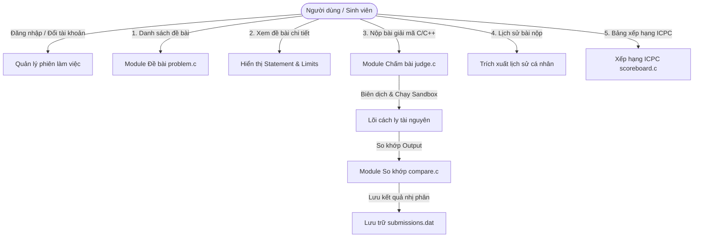
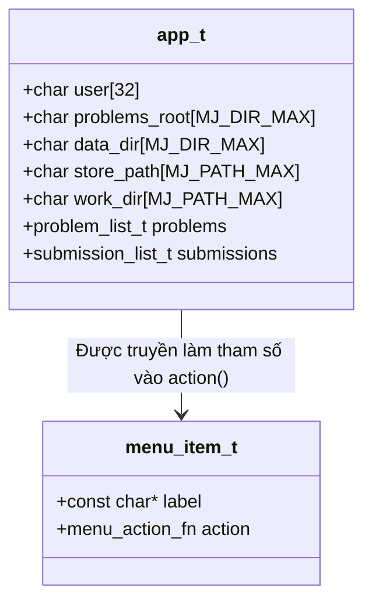
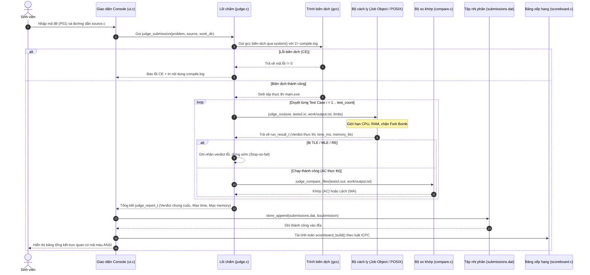
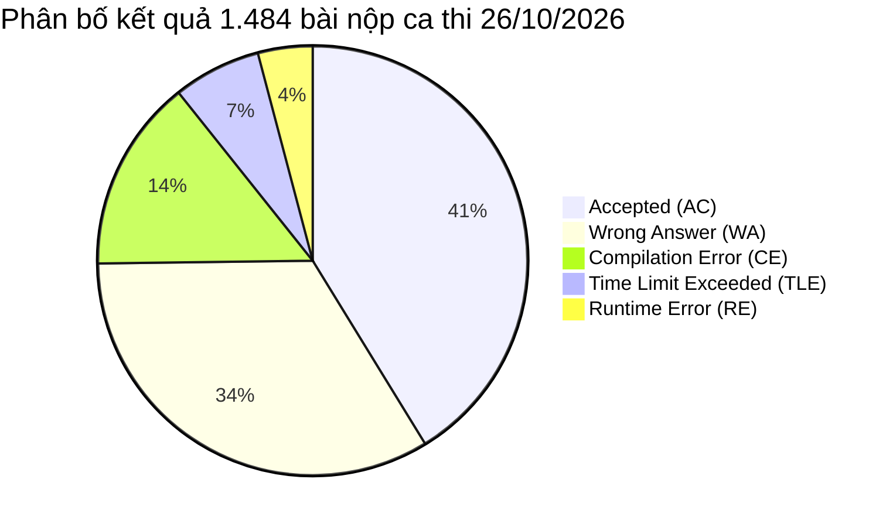

# TRƯỜNG ĐẠI HỌC GIAO THÔNG VẬN TẢI
## PHÂN HIỆU TẠI THÀNH PHỐ HỒ CHÍ MINH
### KHOA CÔNG NGHỆ THÔNG TIN — BỘ MÔN KỸ THUẬT LẬP TRÌNH C

---

<br><br><br>

# BÁO CÁO BÀI TẬP LỚN
## ĐỀ TÀI: XÂY DỰNG HỆ THỐNG CHẤM BÀI TẬP LẬP TRÌNH TỰ ĐỘNG (MINIJUDGE) TRÊN NỀN TẢNG C11 VÀ MỞ RỘNG WEB PLATFORM

<br><br>

**Học phần:** Kỹ thuật Lập trình  
**Mã học phần:** IT2026  
**Lớp:** K67 - Công nghệ Thông tin  
**Giảng viên hướng dẫn:** Bộ môn Kỹ thuật Lập trình  

<br>

**Nhóm sinh viên thực hiện (Nhóm MiniJudge):**
1. **Trần Công Tuấn** — *Nhóm trưởng* (Phụ trách: Lõi chấm `judge.c`, Sandbox Windows/Linux, Hệ thống & Mở rộng Web)
2. **Nguyễn Ngọc Bảo Trân** — *Thành viên* (Phụ trách: Thiết kế Struct, Mảng động, Quản lý File nhị phân `submissions.dat`)
3. **Võ Thị Bích Trâm** — *Thành viên* (Phụ trách: Thuật toán so khớp, Xếp hạng ICPC, Quản lý vòng đời bộ nhớ)
4. **Lê Thái Tuấn** — *Thành viên* (Phụ trách: Giao diện Console, Xử lý nhập liệu an toàn, Bộ mẫu kiểm thử & Ngoại lệ)

<br><br><br>

**TP. Hồ Chí Minh — Tháng 11/2026**

<div style="page-break-after: always;"></div>

---

# LỜI NÓI ĐẦU

Trong tiến trình chuyển đổi số và nâng cao chất lượng đào tạo công nghệ thông tin, việc rèn luyện tư duy thuật toán và kỹ năng lập trình là nền tảng cốt lõi đối với mỗi sinh viên. Các kỳ thi lập trình quốc tế (ICPC), Olympic Tin học sinh viên (OLP) cũng như các nền tảng trực tuyến lớn như Codeforces, LeetCode, VNOJ đã chứng minh vai trò không thể thay thế của các **Hệ thống chấm bài tự động (Automated Grading System / Online Judge)**. Một hệ thống chấm tự động không chỉ giải phóng hoàn toàn thời gian chấm bài thủ công của giảng viên, mà còn mang lại tính công bằng tuyệt đối, phản hồi tức thời kết quả thực thi và giúp sinh viên tự điều chỉnh tư duy thuật toán ngay trong quá trình giải bài.

Tuy nhiên, phần lớn các hệ thống Online Judge phổ biến hiện nay (như DOMjudge, DMOJ, VNOJ) đều được thiết kế cho quy mô máy chủ doanh nghiệp phức tạp, đòi hỏi cấu hình hạ tầng mạng lớn, các dịch vụ ảo hóa cồng kềnh (Docker daemon, Kubernetes, message broker) và không thể chạy độc lập trên môi trường máy đơn (standalone) hoặc phòng thực hành trường học không có kết nối Internet. Ngược lại, một số phần mềm chấm bài offline truyền thống như Themis lại phụ thuộc chặt chẽ vào một hệ điều hành cụ thể (Windows 32-bit cũ), thiếu cơ chế cách ly tiến trình hiện đại và dễ bị tê liệt bởi các chương trình sinh viên chứa lỗi vòng lặp vô hạn, chiếm dụng bộ nhớ hoặc cố tình can thiệp hệ thống tệp.

Xuất phát từ yêu cầu thực tiễn đó, trong khuôn khổ môn học **Kỹ thuật Lập trình**, nhóm chúng em đã nghiên cứu và phát triển dự án **MiniJudge** — một hệ thống chấm bài lập trình tự động nhỏ gọn nhưng mạnh mẽ, tuân thủ tiêu chuẩn ngôn ngữ **C11 nguyên bản**, không phụ thuộc thư viện bên ngoài (zero-dependency). Đặc biệt, hệ thống được thiết kế theo kiến trúc module hóa linh hoạt:
- **Giao diện Console (C11 thuần):** Phục vụ môi trường thực hành nhẹ nhàng, demo trực tiếp và đáp ứng trọn vẹn yêu cầu học thuật của môn học.
- **Lõi chấm độc lập (Core Engine):** Đóng gói hoàn chỉnh các kỹ thuật hệ thống cấp thấp (Low-level System Calls) để cách ly tiến trình (Process Sandboxing), giới hạn thời gian/bộ nhớ và so khớp output trên cả hai nền tảng phổ biến nhất hiện nay: Windows (Win32 Job Object & I/O Completion Port) và Linux/POSIX (`fork`, `dup2`, `setrlimit`, `wait4`).
- **Mở rộng Web Platform:** Cung cấp giao diện web hiện đại, cho phép kết nối toàn bộ phòng máy hoặc lớp học thông qua trình duyệt web với hạ tầng container hóa và Cloudflare Tunnel an toàn.

Báo cáo này trình bày toàn bộ quá trình nghiên cứu, phân tích bài toán, thiết kế kiến trúc cấu trúc dữ liệu, cài đặt thuật toán chi tiết và các kết quả kiểm thử thực tế thu được, đặc biệt là dữ liệu thực nghiệm từ ca thi thực tế của hơn 90 sinh viên với 1.484 bài nộp.

Chúng em xin bày tỏ lòng biết ơn chân thành đến Quý Thầy/Cô Bộ môn Kỹ thuật Lập trình đã nhiệt tình giảng dạy, trang bị cho chúng em những kiến thức nền tảng vững chắc về con trỏ, cấp phát bộ nhớ động, quản lý tệp và tư duy tối ưu hóa giải thuật để hoàn thành tốt bài tập lớn này.

<div style="page-break-after: always;"></div>

---

# MỤC LỤC

- **LỜI NÓI ĐẦU**
- **CHƯƠNG 1. PHÂN TÍCH BÀI TOÁN & THIẾT KẾ MENU CONSOLE**
  - 1.1. Bối cảnh bài toán chấm bài tự động & Khảo sát các hệ thống hiện hành
  - 1.2. Phân tích yêu cầu chức năng (Functional Requirements)
  - 1.3. Phân tích yêu cầu phi chức năng (Non-Functional Requirements)
  - 1.4. Thiết kế cấu trúc Menu Console & Kỹ thuật Bảng con trỏ hàm (Function Pointer Table)
- **CHƯƠNG 2. THIẾT KẾ CẤU TRÚC DỮ LIỆU & LUỒNG DỮ LIỆU**
  - 2.1. Thiết kế các cấu trúc dữ liệu cốt lõi (`struct`)
  - 2.2. Cơ chế mảng động tự co giãn & Phân tích chi phí khấu hao O(1)
  - 2.3. Thiết kế định dạng lưu trữ file: Văn bản (`problem.txt`) & Nhị phân (`submissions.dat`)
  - 2.4. Sơ đồ luồng dữ liệu tổng thể (Data Flow Diagram - DFD)
- **CHƯƠNG 3. CÀI ĐẶT KỸ THUẬT CHI TIẾT**
  - 3.1. Kỹ thuật biên dịch mã nguồn & Trích xuất log lỗi tự động
  - 3.2. Cơ chế Sandbox trên Windows: Win32 Job Object, Completion Port & Đo thời gian CPU
  - 3.3. Cơ chế Sandbox trên Linux/POSIX: `fork`, `dup2`, `setrlimit`, `wait4` & Hạ đặc quyền
  - 3.4. Thuật toán so khớp Output nghiêm ngặt & Bảng xếp hạng chuẩn ICPC
  - 3.5. Kỹ thuật nhập liệu an toàn & Chống lỗi bộ đệm người dùng
  - 3.6. Chiến lược quản lý vòng đời bộ nhớ & Phòng chống rò rỉ (Memory Leaks)
- **CHƯƠNG 4. KẾT QUẢ THỬ NGHIỆM & ĐÁNH GIÁ THỰC TẾ**
  - 4.1. Bảng ma trận kiểm thử 8 bài mẫu (`samples/`) & 6 loại phán quyết
  - 4.2. Thử nghiệm hiệu năng giải thuật (O(N) vs O(N·K) trên tập dữ liệu 2·10⁵)
  - 4.3. Kiểm định an toàn bộ nhớ với Valgrind và Dr. Memory
  - 4.4. Xử lý các tình huống ngoại lệ biên (Edge Cases & Resilience)
  - 4.5. Thực nghiệm triển khai diện rộng: Dữ liệu ca thi 26/10/2026 (1.484 bài nộp, 90 sinh viên)
  - 4.6. Mở rộng hệ thống: Kiến trúc Web Full-stack tích hợp Core C (`judge-cli`)
- **KẾT LUẬN & HƯỚNG PHÁT TRIỂN**
- **TÀI LIỆU THAM KHẢO**
- **PHỤ LỤC: PHÂN CÔNG NHIỆM VỤ & TỶ LỆ ĐÓNG GÓP**

<div style="page-break-after: always;"></div>

---

# CHƯƠNG 1. PHÂN TÍCH BÀI TOÁN & THIẾT KẾ MENU CONSOLE

## 1.1. Bối cảnh bài toán chấm bài tự động & Khảo sát các hệ thống hiện hành

Trong giảng dạy và luyện thi lập trình (đặc biệt là các kỳ thi học thuật như ICPC, Olympic Tin học, HSG Quốc gia), phương pháp đánh giá sinh viên dựa trên việc đọc mã nguồn thủ công bộc lộ rất nhiều hạn chế:
1. **Thiếu tính khách quan và tức thời:** Giảng viên hoặc trợ giảng mất hàng giờ đồng hồ để tải bài, biên dịch, nhập từng test case và ghi nhận kết quả. Sinh viên không nhận được phản hồi ngay lập tức để nhận diện lỗi sai trong tư duy giải thuật.
2. **Khó kiểm soát tài nguyên:** Chấm thủ công không thể đo lường chính xác mili-giây thời gian CPU hay dung lượng RAM mà chương trình tiêu thụ, dẫn đến việc bỏ qua các thuật toán có độ phức tạp cao hoặc rò rỉ bộ nhớ.
3. **Nguy cơ mất an toàn hệ thống:** Khi thực thi mã nguồn do sinh viên gửi lên, máy tính của người chấm có nguy cơ bị treo cứng do vòng lặp vô tận, tràn bộ nhớ (OOM crash), hoặc bị can thiệp nguy hiểm nếu mã nguồn chứa các hàm xóa tệp hệ thống (`system("rm -rf /")`, `system("shutdown -s")`).

Để giải quyết bài toán trên, các hệ sinh thái Online Judge (OJ) đã ra đời và phát triển mạnh mẽ. Qua khảo sát thực tế, nhóm phân tích các hệ thống tiêu biểu:

| Hệ thống | Điểm mạnh | Hạn chế | Khả năng ứng dụng phòng lab |
|---|---|---|---|
| **Codeforces / Polygon** | Chuẩn quốc tế, checker mạnh mẽ, bảng điểm thời gian thực, cộng đồng hàng triệu người dùng. | Mã nguồn đóng ở tầng máy chấm, phụ thuộc hoàn toàn vào cloud, không thể chạy nội bộ trên máy cá nhân. | Không khả thi (không hỗ trợ chạy offline). |
| **VNOJ (SPOJ fork / DMOJ)** | Giao diện tiếng Việt thân thiện, kho bài tập phong phú, hỗ trợ nhiều ngôn ngữ. | Hạ tầng phức tạp (Django, Celery, Redis, Docker), đòi hỏi máy chủ cấu hình mạnh và quản trị viên chuyên nghiệp. | Khó triển khai trên máy tính sinh viên hoặc phòng máy lẻ. |
| **Themis** | Rất phổ biến tại các trường THPT chuyên ở Việt Nam, giao diện GUI dễ dùng, không cần cấu hình mạng. | Thiết kế từ thời Windows XP/7 (32-bit), phụ thuộc vào Delphi/Pascal, không hỗ trợ Linux, cơ chế bắt TLE/MLE yếu và dễ bị treo giao diện khi bài nộp crash. | Hạn chế (chỉ chạy trên Windows, công nghệ cũ). |
| **DOMjudge** | Tiêu chuẩn vàng của các kỳ thi ICPC toàn cầu, tính chính xác và bảo mật cực cao. | Yêu cầu máy chủ Linux chuyên dụng, cấu hình sudoers, cgroups, chroot phức tạp. | Quá nặng cho bài tập lớn cá nhân/nhóm nhỏ. |

### Định vị của MiniJudge
MiniJudge được định hướng là một giải pháp dung hòa tối ưu:
- **Ngôn ngữ C11 thuần khiết:** Toàn bộ lõi chấm và giao diện console được viết bằng C11, đạt hiệu năng tối đa, không cần cài đặt bất kỳ runtime phụ trợ nào (Python, Java, Node.js đều không bắt buộc đối với bản Console).
- **Kiến trúc "Lõi duy nhất — Đa giao diện" (Single Core — Dual Interface):** Phần lõi chấm (`core/`) đóng vai trò thư viện dùng chung cho cả ứng dụng Console tương tác trực tiếp (`minijudge`) và công cụ dòng lệnh xuất JSON (`judge-cli`) phục vụ mở rộng nền tảng Web.
- **Tương thích đa nền tảng (Cross-platform Sandboxing):** Cài đặt độc lập 2 driver cách ly tài nguyên: Win32 API trên Windows và POSIX System Calls trên Linux/macOS.

---

## 1.2. Phân tích yêu cầu chức năng (Functional Requirements)

Hệ thống MiniJudge đáp ứng đầy đủ chu trình khép kín của một kỳ thi lập trình thực tế, bao gồm 5 nhóm chức năng chính:



1. **Quản lý đề bài (Problem Management):**
   - Đọc cấu hình từ thư mục `problems/` thông qua chỉ mục `index.txt`.
   - Mỗi bài tập được cấu hình qua tệp `problem.txt` gồm: Mã đề (`id`), Tên đề bài (`title`), Giới hạn thời gian (`time_ms`), Giới hạn bộ nhớ (`memory_mb`), Số lượng bộ test (`tests`).
   - Đọc đề bài chi tiết từ tệp `statement.txt` để hiển thị cho sinh viên trực tiếp trên console.
2. **Nộp bài & Chấm tự động (Submission & Automated Evaluation):**
   - Người dùng nhập đường dẫn tệp mã nguồn C/C++ (`.c`, `.cpp`).
   - Hệ thống tự động biên dịch sang tệp thực thi trung gian trong thư mục làm việc tạm (`work/`).
   - Thực thi chương trình lần lượt qua các cặp test `tests/i.in` và `tests/i.out` (1 <= i <= tests).
   - Đánh giá và trả về một trong 6 mã phán quyết chuẩn:
     - `AC` (Accepted): Chương trình chạy đúng toàn bộ test case trong giới hạn thời gian và bộ nhớ.
     - `WA` (Wrong Answer): Kết quả xuất ra khác với đáp án chuẩn.
     - `TLE` (Time Limit Exceeded): Thời gian thực thi CPU vượt quá ngưỡng cho phép.
     - `MLE` (Memory Limit Exceeded): Lượng bộ nhớ RAM chiếm dụng vượt quá giới hạn.
     - `RE` (Runtime Error): Chương trình kết thúc với mã lỗi khác 0, truy cập vùng nhớ bất hợp pháp (Segmentation Fault / Access Violation) hoặc chia cho 0.
     - `CE` (Compilation Error): Mã nguồn lỗi cú pháp, không thể biên dịch thành công. Trích xuất toàn bộ log của `gcc` để sinh viên đối chiếu sửa lỗi.
3. **Lưu trữ lịch sử nộp bài (Persistent History):**
   - Tự động gán mã nộp bài tăng dần (`id`), lưu trữ định danh người dùng (`user`), mã bài (`problem_id`), phán quyết (`verdict`), thời gian chạy (`time_ms`), bộ nhớ đỉnh (`memory_kb`), số test đạt và thời điểm nộp (`submitted_at`).
   - Dữ liệu được ghi bền vững vào tệp nhị phân `submissions.dat` để đảm bảo không bị mất khi thoát ứng dụng.
4. **Bảng xếp hạng thời gian thực theo luật ICPC (Real-time ICPC Leaderboard):**
   - Tổng hợp toàn bộ bài nộp hợp lệ trong hệ thống.
   - Áp dụng chuẩn chấm điểm ICPC quốc tế:
     - Xếp thứ hạng ưu tiên theo: (1) Số bài giải được (`solved`) giảm dần -> (2) Điểm phạt (`penalty`) tăng dần -> (3) Tên người dùng theo thứ tự từ điển.
     - Điểm phạt một bài giải được: Penalty = T_AC + 20 * W, trong đó T_AC là số phút tính từ đầu contest đến khi có bài AC đầu tiên, và W là số lần nộp sai (`WA`, `TLE`, `MLE`, `RE`) trước khi bài được `AC`. Các lần nộp sau khi đã `AC` hoặc các bài bị lỗi biên dịch `CE` không bị tính penalty.
5. **Quản lý phiên người dùng (User Session):**
   - Hỗ trợ đổi người dùng (`action_switch_user`) để nhiều sinh viên có thể kiểm thử luân phiên trên cùng một máy chấm console mà không phải khởi động lại chương trình.

---

## 1.3. Phân tích yêu cầu phi chức năng (Non-Functional Requirements)

Để một hệ thống chấm bài vận hành ổn định trong môi trường giáo dục, các yêu cầu phi chức năng sau mang tính chất sống còn:

1. **Tính an toàn và cách ly tiến trình (Process Sandboxing & Safety):**
   - **Chống Fork Bomb:** Sinh viên có thể vô tình hoặc cố ý viết mã tạo tiến trình con liên tục (`while(1) fork();`), làm cạn kiệt bảng tiến trình của hệ điều hành và gây tê liệt máy chấm. Hệ thống phải chặn đứng việc tạo tiến trình phụ (`ActiveProcessLimit = 1` trên Windows, `RLIMIT_NPROC = 1` trên Linux).
   - **Chống chiếm dụng RAM (Out of Memory):** Nếu chương trình sinh viên cấp phát mảng động khổng lồ (`malloc(1024 * 1024 * 1024)`), hệ điều hành có thể phải kích hoạt OOM Killer hoặc treo toàn bộ máy chấm. MiniJudge phải áp đặt trần bộ nhớ ảo cấp độ nhân (Kernel Job Object / `setrlimit`).
   - **Chống tràn đĩa (Disk Flooding):** Ngăn chặn bài nộp ghi file vô hạn bằng cách chuyển hướng luồng ghi sang `/dev/null` hoặc tệp tạm bị giới hạn dung lượng (`RLIMIT_FSIZE = 64MB`).
2. **Độ chính xác trong đo lường tài nguyên:**
   - Phải đo thời gian tiêu thụ CPU thực tế của tiến trình (`User CPU Time` + `Kernel CPU Time`), tuyệt đối không dùng hàm đo thời gian đồng hồ treo tường (`Wall-clock time` như `clock()` hoặc `time()`), vì thời gian đồng hồ bị ảnh hưởng bởi độ trễ điều phối (scheduling latency) của hệ điều hành khi máy bận, gây ra phán quyết TLE sai cho sinh viên.
3. **Tính toàn vẹn bộ nhớ trong mã nguồn C (Memory Safety):**
   - Bản thân chương trình MiniJudge được viết bằng C, do đó phải tuân thủ nghiêm ngặt nguyên tắc cấp phát và giải phóng bộ nhớ. Mọi con trỏ cấp phát động (`malloc`, `calloc`, `realloc`) phải được giải phóng hoàn toàn (`free`) trước khi kết thúc phiên làm việc, đạt chuẩn `0 byte leak` khi kiểm định bằng Valgrind hoặc Dr. Memory.
4. **Tính di động (Portability):**
   - Mã nguồn không được sử dụng các phần mở rộng phi chuẩn của trình biên dịch; tách biệt hoàn toàn tầng logic nghiệp vụ (`problem.c`, `scoreboard.c`, `compare.c`) khỏi tầng giao tiếp hệ điều hành (`run-windows.c`, `run-posix.c`).

---

## 1.4. Thiết kế cấu trúc Menu Console & Kỹ thuật Bảng con trỏ hàm (Function Pointer Table)

### Hạn chế của thiết kế kinh điển bằng `switch-case`
Trong các bài tập lập trình cơ bản, sinh viên thường xây dựng menu tương tác bằng vòng lặp `while(1)` kết hợp cấu trúc `switch(choice)`. Khi hệ thống phát triển lớn, phương pháp này để lộ các khuyết điểm:
- Vi phạm nguyên lý **Open/Closed Principle (OCP)** trong kỹ nghệ phần mềm: Mỗi khi bổ sung một chức năng mới, lập trình viên buộc phải can thiệp sửa đổi trực tiếp vào khối lệnh điều khiển trung tâm trong hàm `main()`, tiềm ẩn rủi ro phá vỡ luồng điều khiển sẵn có.
- Khối `switch-case` phình to hàng trăm dòng, làm suy giảm tính đọc hiểu và khó kiểm thử đơn vị (Unit Test).

### Giải pháp kiến trúc của MiniJudge: Bảng con trỏ hàm (Dispatch Table)
MiniJudge áp dụng kỹ thuật hướng đối tượng trong C thông qua cấu trúc **Mảng con trỏ hàm** (`menu_item_t`). Kiến trúc này tách rời hoàn toàn giao diện hiển thị, bảng ánh xạ và logic xử lý của từng chức năng.



Định nghĩa kiểu con trỏ hàm xử lý menu trong `console/app.h`:
```c
/* Con trỏ hàm nhận vào con trỏ ngữ cảnh ứng dụng app_t */
typedef void (*menu_action_fn)(app_t *app);

typedef struct {
    const char *label;      /* Tên hiển thị của chức năng trên menu */
    menu_action_fn action;  /* Con trỏ trỏ tới hàm xử lý tương ứng */
} menu_item_t;
```

Bảng đăng ký chức năng trong `console/main.c`:
```c
/* Menu điều khiển bằng bảng con trỏ hàm: thêm chức năng chỉ cần thêm 1 dòng */
static const menu_item_t MENU[] = {
    {"Danh sach de bai",           action_list_problems},
    {"Xem de bai",                 action_view_statement},
    {"Nop bai",                    action_submit},
    {"Lich su nop bai cua toi",    action_history},
    {"Bang xep hang (luat ICPC)",  action_scoreboard},
    {"Doi nguoi dung",             action_switch_user},
};
static const int MENU_SIZE = (int)(sizeof MENU / sizeof MENU[0]);
```

Vòng lặp điều phối (Event Dispatching Loop) trong hàm `main()` trở nên cực kỳ tinh gọn và không bao giờ phải sửa đổi:
```c
for (;;) {
    print_menu(&app);
    int choice;
    if (ui_read_int("Chon chuc nang: ", 0, MENU_SIZE, &choice) != 0 || choice == 0)
        break;
    printf("\n");
    /* Gọi trực tiếp hàm xử lý thông qua con trỏ hàm với độ phức tạp O(1) */
    MENU[choice - 1].action(&app);
    ui_pause();
}
```

**Ưu điểm vượt trội của thiết kế:**
1. **Khả năng mở rộng tuyệt đối:** Để bổ sung chức năng số 7 (ví dụ: `action_export_csv`), lập trình viên chỉ cần khai báo nguyên mẫu hàm và thêm một phần tử vào mảng `MENU[]`. Độ dài mảng `MENU_SIZE` được tiền xử lý tính toán tự động qua toán tử `sizeof`.
2. **Khử hoàn toàn lỗi nhập xuất:** Lựa chọn `choice` được kiểm định chặt chẽ trong khoảng `[0, MENU_SIZE]`, ngăn chặn triệt để lỗi truy cập ngoài biên mảng (Out-of-bounds Array Indexing).
3. **Quản lý ngữ cảnh thống nhất:** Toàn bộ trạng thái phiên làm việc (danh sách đề, dữ liệu bài nộp, đường dẫn tệp) được đóng gói duy nhất trong cấu trúc `app_t`, không sử dụng bất kỳ biến toàn cục nào ngoài các bảng hằng số `static const`.

<div style="page-break-after: always;"></div>

---

# CHƯƠNG 2. THIẾT KẾ CẤU TRÚC DỮ LIỆU & LUỒNG DỮ LIỆU

## 2.1. Thiết kế các cấu trúc dữ liệu cốt lõi (`struct`)

Hệ thống MiniJudge được tổ chức thành các cấu trúc dữ liệu tường minh, chặt chẽ, tối ưu hóa theo quy chuẩn bộ nhớ của ngôn ngữ C11.

### 2.1.1. Kiểu liệt kê phán quyết (`verdict_t`) & Cấu trúc giới hạn (`judge_limits_t`)
```c
typedef enum {
    VERDICT_AC,       /* Accepted: Kết quả chính xác */
    VERDICT_WA,       /* Wrong Answer: Sai kết quả đầu ra */
    VERDICT_TLE,      /* Time Limit Exceeded: Quá thời gian CPU */
    VERDICT_MLE,      /* Memory Limit Exceeded: Quá giới hạn RAM */
    VERDICT_RE,       /* Runtime Error: Lỗi thực thi / crash */
    VERDICT_CE,       /* Compilation Error: Lỗi biên dịch mã nguồn */
    VERDICT_IE,       /* Internal Error: Lỗi hệ thống nội bộ máy chấm */
    VERDICT_PENDING,  /* Pending: Đang chờ chấm */
    VERDICT_COUNT
} verdict_t;

typedef struct {
    int time_ms;      /* Giới hạn thời gian (mili-giây) */
    int memory_mb;    /* Giới hạn bộ nhớ (Megabyte) */
} judge_limits_t;
```

### 2.1.2. Kết quả kiểm thử đơn lẻ (`run_result_t`) & Báo cáo tổng thể (`judge_report_t`)
Mỗi lần thực thi một test case sinh ra một cấu trúc `run_result_t`. Khi kết thúc toàn bộ bộ test, hàm chấm đóng gói thành một `judge_report_t`:

```c
typedef struct {
    verdict_t verdict;   /* Phán quyết riêng của test case này */
    int time_ms;         /* Thời gian CPU đã tiêu thụ (ms) */
    long memory_kb;      /* Lượng RAM đỉnh đã dùng (KB) */
    int exit_code;       /* Mã thoát của tiến trình con */
} run_result_t;

typedef struct {
    verdict_t verdict;   /* Phán quyết chung cuộc của lần nộp */
    int test_count;      /* Tổng số test case đã chạy */
    int tests_passed;    /* Số test case vượt qua (AC) */
    int max_time_ms;     /* Thời gian lớn nhất trong các test đã chạy */
    long max_memory_kb;  /* Bộ nhớ đỉnh lớn nhất trong các test đã chạy */
    run_result_t *tests; /* Con trỏ trỏ tới mảng động các kết quả test */
    char *compile_log;   /* Con trỏ chuỗi động lưu thông báo lỗi gcc (nếu CE) */
    char *fail_output;   /* Preview đầu ra thực tế của test đầu tiên bị sai */
} judge_report_t;
```

### 2.1.3. Cấu trúc bài toán (`problem_t`) & Danh sách đề bài (`problem_list_t`)
```c
typedef struct {
    char id[16];           /* Mã đề: ví dụ "P01", "K13_01" */
    char title[128];       /* Tiêu đề đề bài: "Tong hai so", "Doan con lon nhat" */
    int time_ms;           /* Giới hạn thời gian CPU (ms) */
    int memory_mb;         /* Giới hạn RAM (MB) */
    int test_count;        /* Tổng số test case sẵn có trong thư mục tests/ */
    char dir[MJ_DIR_MAX];  /* Đường dẫn tuyệt đối/tương đối tới thư mục đề */
} problem_t;

typedef struct {
    problem_t *items;      /* Mảng động các cấu trúc problem_t */
    int count;             /* Số đề bài hiện có trong mảng */
    int capacity;          /* Sức chứa tối đa hiện tại của mảng động */
} problem_list_t;
```

### 2.1.4. Bản ghi bài nộp nhị phân (`submission_t`)
Cấu trúc `submission_t` được thiết kế có kích thước cố định (fixed-size struct) không chứa con trỏ, cho phép ghi thẳng nguyên khối xuống tệp nhị phân thông qua hàm `fwrite`:

```c
typedef struct {
    int id;                 /* Mã định danh bài nộp duy nhất (1, 2, 3...) */
    char user[32];          /* Tên người dùng nộp bài (chuỗi ASCII an toàn) */
    char problem_id[16];    /* Mã đề bài tương ứng */
    int verdict;            /* Giá trị nguyên ánh xạ từ verdict_t */
    int time_ms;            /* Thời gian chạy tối đa (ms) */
    long memory_kb;         /* Bộ nhớ đỉnh tối đa (KB) */
    int tests_passed;       /* Số lượng test AC */
    int test_count;         /* Tổng số test của bài */
    long long submitted_at; /* Dấu thời gian Unix Epoch (giây) */
} submission_t;

typedef struct {
    submission_t *items;    /* Mảng động chứa toàn bộ lịch sử bài nộp */
    int count;
    int capacity;
} submission_list_t;
```

### 2.1.5. Cấu trúc bảng xếp hạng ICPC (`scoreboard_t`)
Mỗi ô trên bảng điểm thể hiện tiến độ của một thí sinh trên một bài toán cụ thể:
```c
typedef struct {
    int solved;          /* Cờ đánh dấu: 1 nếu đã AC, 0 nếu chưa */
    int wrong;           /* Số lần nộp sai trước khi đạt AC */
    long long ac_minute; /* Số phút tính từ đầu contest đến lúc nộp AC */
} score_cell_t;

typedef struct {
    char user[32];       /* Tên thí sinh */
    int solved;          /* Tổng số bài đã giải thành công */
    long long penalty;   /* Tổng số điểm phạt ICPC */
    score_cell_t *cells; /* Mảng động gồm problem_count phần tử */
} score_row_t;

typedef struct {
    score_row_t *rows;   /* Mảng động danh sách các dòng điểm số */
    int count;           /* Số lượng thí sinh trên bảng xếp hạng */
    int capacity;        /* Sức chứa hiện tại của mảng rows */
    int problem_count;   /* Số lượng bài thi trong contest */
} scoreboard_t;
```

---

## 2.2. Cơ chế mảng động tự co giãn & Phân tích chi phí khấu hao O(1)

Trong ngôn ngữ C, kích thước mảng tĩnh phải được xác định tại thời điểm biên dịch, gây lãng phí bộ nhớ nếu khai báo quá lớn hoặc làm sập chương trình khi dữ liệu vượt ngưỡng. Để quản lý danh sách đề bài (`problem_list_t`) và danh sách bài nộp (`submission_list_t`), MiniJudge cài đặt cơ chế **Mảng động tự nhân đôi sức chứa (Doubling Strategy)**.

Mô hình cài đặt hàm chèn trong `core/src/submission-store.c`:
```c
static int list_push(submission_list_t *list, const submission_t *s) {
    if (list->count == list->capacity) {
        /* Chiến lược nhân đôi: nếu mảng rỗng khởi tạo 16, ngược lại nhân 2 */
        int cap = list->capacity ? list->capacity * 2 : 16;
        submission_t *tmp = realloc(list->items, (size_t)cap * sizeof *tmp);
        if (!tmp) return -1; /* Bảo toàn con trỏ cũ nếu realloc thất bại */
        list->items = tmp;
        list->capacity = cap;
    }
    list->items[list->count++] = *s;
    return 0;
}
```

### Phân tích toán học độ phức tạp: Tại sao chi phí khấu hao là O(1)?
Một sai lầm phổ biến là cho rằng mỗi lần mảng đầy, hàm `realloc` phải sao chép toàn bộ mảng cũ sang vùng nhớ mới nên thao tác chèn có độ phức tạp O(N), dẫn đến N thao tác chèn sẽ tốn O(N^2). Điều này chỉ đúng nếu chúng ta tăng sức chứa theo từng đơn vị hằng số (capacity = capacity + 1).

Khi áp dụng chiến lược nhân đôi (capacity * 2), ta chứng minh độ phức tạp trung bình của mỗi thao tác thêm phần tử đạt O(1) thông qua **Phương pháp Kế toán (Accounting Method)**:

1. **Chi phí thực tế c_i của thao tác thứ i:**
   - Nếu không xảy ra giãn mảng (trường hợp thông thường): c_i = 1 (chỉ thực hiện phép gán vào `items[count]`).
   - Nếu xảy ra giãn mảng tại phần tử thứ i = 2^k + 1: Ta phải cấp phát mảng mới gấp đôi và sao chép i - 1 phần tử cũ sang mảng mới, sau đó chèn phần tử mới. Do đó: c_i = (i - 1) + 1 = i.

2. **Gán chi phí khấu hao ĉ_i:**
   Quy ước mỗi khi thêm một phần tử vào mảng, ta thu một khoản "phí" là ĉ_i = 3 đơn vị tín dụng (credits):
   - 1 tín dụng dùng để trả trực tiếp cho chi phí chèn chính phần tử đó vào bộ nhớ.
   - 2 tín dụng còn lại được lưu giữ trong "tài khoản tiết kiệm" của phần tử đó để phục vụ cho các lần sao chép trong tương lai.

3. **Chứng minh số dư tài khoản luôn không âm:**
   Giả sử mảng vừa nhân đôi ở kích thước M và hiện tại có M phần tử. Lần nhân đôi tiếp theo sẽ diễn ra khi mảng đầy 2M phần tử.
   - Trong quá trình chèn M phần tử mới (từ phần tử thứ M + 1 đến 2M), mỗi phần tử mới đóng góp 2 tín dụng vào quỹ tiết kiệm.
   - Tổng số tín dụng tích lũy được sau khi chèn M phần tử mới là: ΔCredit = M * 2 = 2M tín dụng.
   - Khi phần tử thứ 2M + 1 được chèn vào, mảng buộc phải nhân đôi lên kích thước 4M. Chi phí sao chép 2M phần tử hiện có sang vùng nhớ mới là đúng 2M thao tác.
   - Toàn bộ chi phí sao chép này được thanh toán hoàn toàn bằng 2M tín dụng tích lũy từ quỹ tiết kiệm mà không phát sinh thêm chi phí nào: Số dư quỹ sau sao chép = 2M - 2M = 0 >= 0.

Vì số dư tài khoản luôn lớn hơn hoặc bằng 0 tại mọi thời điểm N, tổng chi phí thực tế luôn bị chặn trên bởi tổng chi phí khấu hao:
Tổng chi phí thực tế <= Tổng chi phí khấu hao = 3N = O(N)

Trung bình trên N phần tử, mỗi thao tác thêm mới chỉ tốn:
Chi phí khấu hao (Amortized Cost) = O(N) / N = O(1)

**Kết luận:** Cơ chế mảng động tự nhân đôi trong MiniJudge đảm bảo tốc độ ghi nhận bài nộp tối ưu tương đương mảng tĩnh nhưng hoàn toàn linh hoạt về mặt kích thước bộ nhớ.

---

## 2.3. Thiết kế định dạng lưu trữ file: Văn bản (`problem.txt`) & Nhị phân (`submissions.dat`)

Hệ thống kết hợp hài hòa hai hình thức lưu trữ tệp tùy theo đặc thù dữ liệu:

### 2.3.1. Cấu hình đề bài văn bản (`problem.txt`)
Dữ liệu đề bài cần tính trực quan cao để người ra đề (giáo viên, trợ giảng) có thể dễ dàng soạn thảo, chỉnh sửa bằng bất kỳ trình soạn thảo văn bản nào. Cấu trúc tệp tuân thủ cú pháp `key=value`:
```ini
# Cấu hình đề bài mẫu P01
title=Tong hai so
time_ms=1000
memory_mb=256
tests=10
```
- Module `problem.c` sử dụng hàm `fgets` kết hợp hàm tiện ích `mj_trim` để loại bỏ khoảng trắng và ký tự xuống dòng dư thừa, sau đó tìm dấu tách `=` bằng `strchr`. Mọi dòng bắt đầu bằng ký tự `#` đều được xem là chú thích và tự động bỏ qua.

### 2.3.2. Cơ sở dữ liệu bài nộp nhị phân (`submissions.dat`)
Trái ngược với cấu hình đề bài, lịch sử nộp bài (`submissions.dat`) là dữ liệu có tần suất đọc/ghi rất cao (mỗi bài nộp được chấm xong lập tức được ghi vào đĩa, và mỗi lần mở menu/bảng xếp hạng đều phải duyệt lại toàn bộ).

MiniJudge lựa chọn định dạng **File nhị phân thuần (Raw Binary File)** với cấu trúc như sau:

```
+------------------+-----------------------+-----------------------+-----+
| Magic (4 bytes)  |  Record 1 (64 bytes)  |  Record 2 (64 bytes)  | ... |
| "M" "J" "S" "1"  |     submission_t      |     submission_t      |     |
+------------------+-----------------------+-----------------------+-----+
```

1. **4-byte Magic Number (`MJS1`):**
   - Đóng vai trò chữ ký nhận dạng định dạng tệp. 4 byte đầu tiên luôn là các ký tự mã ASCII: `0x4D, 0x4A, 0x53, 0x31` (`"MJS1"` — viết tắt của *MiniJudge Submission Version 1*).
   - Khi nạp tệp qua hàm `store_load()`, chương trình kiểm tra chữ ký này đầu tiên:
     ```c
     char magic[4];
     if (fread(magic, 1, sizeof magic, f) != sizeof magic ||
         memcmp(magic, STORE_MAGIC, sizeof magic) != 0) {
         fclose(f);
         return -1; /* Tệp hỏng hoặc không đúng định dạng */
     }
     ```
   - Nhờ đó, nếu người dùng vô tình chỉ định nhầm tệp văn bản khác, hệ thống sẽ từ chối ngay lập tức thay vì đọc dữ liệu rác gây sập chương trình.

2. **So sánh định dạng Nhị phân vs. Định dạng Text/JSON:**

| Tiêu chí | File nhị phân `submissions.dat` (MiniJudge) | File văn bản / JSON (`submissions.json`) |
|---|---|---|
| **Tốc độ ghi đĩa** | Cực nhanh: `fwrite(&s, sizeof s, 1, f)` ghi trực tiếp khối nhị phân từ RAM xuống ổ đĩa. | Chậm: Phải tuần tự hóa (serialize) từng trường thành chuỗi ký tự qua `sprintf`/JSON library. |
| **Tốc độ đọc nạp** | Đọc tuần tự từng bản ghi cố định bằng `fread()`, không tốn chi phí phân tích cú pháp (parsing). | Phải đọc chuỗi, xử lý dấu ngoặc, ép kiểu số, tốn nhiều CPU và phân mảnh bộ nhớ. |
| **Dung lượng lưu trữ** | Cố định và tối ưu: Mỗi bản ghi chiếm chính xác kích thước của struct trong bộ nhớ (khoảng 64 bytes). | Tốn dung lượng gấp 3 đến 5 lần do phải lưu tên thuộc tính (`"problem_id": "P01", ...`). |
| **Tính toàn vẹn** | Ngăn chặn việc người dùng chỉnh sửa điểm thủ công bằng Notepad một cách tùy tiện. | Dễ bị can thiệp sửa đổi thủ công dẫn đến sai lệch kết quả thi. |

---

## 2.4. Sơ đồ luồng dữ liệu tổng thể (Data Flow Diagram - DFD)

Sơ đồ trình bày chi tiết hành trình của một giải pháp lập trình từ khi người dùng cung cấp tệp mã nguồn cho đến khi bảng điểm được cập nhật:



<div style="page-break-after: always;"></div>

---

# CHƯƠNG 3. CÀI ĐẶT KỸ THUẬT CHI TIẾT

## 3.1. Kỹ thuật biên dịch mã nguồn & Trích xuất log lỗi tự động

Module `judge.c` chịu trách nhiệm điều phối việc tạo ra tệp thực thi. Việc gọi trình biên dịch được thực hiện qua hàm chuẩn `system()`, kết hợp kỹ thuật chuyển hướng luồng lỗi chuẩn (`stderr` redirection).

### Cài đặt nhận diện ngôn ngữ và chuỗi lệnh biên dịch
```c
int judge_compile(const char *source, const char *exe, const char *log_path, char **log_out) {
    char cmd[MJ_PATH_MAX * 4];
    lang_t lang = detect_lang(source);
    remove(exe); /* Xóa tệp thực thi cũ để tránh nhận nhầm kết quả biên dịch trước */

    if (lang == LANG_CPP) {
        #ifdef _WIN32
        const char *extra = "-Wl,--stack,268435456"; /* Tăng kích thước Stack lên 256MB */
        #else
        const char *extra = "";
        #endif
        snprintf(cmd, sizeof cmd, "g++ -std=c++17 -O2 -Wall %s -o \"%s\" \"%s\" -lm 2> \"%s\"",
                 extra, exe, source, log_path);
    } else {
        #ifdef _WIN32
        const char *extra = "-Wl,--stack,268435456";
        #else
        const char *extra = "";
        #endif
        snprintf(cmd, sizeof cmd, "gcc -std=c11 -O2 -Wall %s -o \"%s\" \"%s\" -lm 2> \"%s\"",
                 extra, exe, source, log_path);
    }

    int rc = system(cmd);
    /* Nếu người gọi yêu cầu nhận log lỗi, đọc toàn bộ tệp log_path vào bộ nhớ */
    if (log_out) *log_out = mj_read_file(log_path, NULL);
    return (rc == 0 && mj_file_exists(exe)) ? 0 : -1;
}
```

### Các điểm nhấn kỹ thuật quan trọng:
1. **Thiết lập chuẩn C11 (`-std=c11`) và Tối ưu hóa mức 2 (`-O2`):** Chuẩn C11 đảm bảo tính hiện đại của cú pháp ngôn ngữ; cờ `-O2` giúp mã thực thi tối ưu hóa luồng lệnh, phản ánh chính xác hiệu năng thuật toán của thí sinh giống các hệ thống chấm quốc tế.
2. **Kỹ thuật chuyển hướng `2> log_path`:** Trình biên dịch `gcc` xuất toàn bộ cảnh báo (warning) và thông báo lỗi cú pháp (syntax error) ra luồng `stderr`. Phép chuyển hướng `2>` bắt trọn vẹn thông điệp này vào tệp `compile.log`. Hàm `mj_read_file` sau đó sẽ nạp chuỗi này vào bộ nhớ heap và gán cho `rep->compile_log`, giúp sinh viên nhìn thấy chính xác số dòng và thông báo lỗi của `gcc` ngay trên màn hình console.
3. **Mở rộng kích thước Stack (`-Wl,--stack,268435456`):** Mặc định trên Windows, trình liên kết của MinGW chỉ cấp phát ngăn xếp (Call Stack) khoảng 2MB. Nếu bài toán yêu cầu thuật toán đệ quy sâu (như DFS duyệt đồ thị N = 10^5), chương trình sẽ bị Stack Overflow và sập (Runtime Error) dù thuật toán hoàn toàn chính xác. Cờ `-Wl,--stack,268435456` mở rộng Call Stack lên đúng 256MB, đảm bảo tính công bằng cho các thuật toán đệ quy.

---

## 3.2. Cơ chế Sandbox trên Windows: Win32 Job Object, Completion Port & Đo thời gian CPU

Hệ sinh thái Windows không cung cấp lệnh `fork` kiểu POSIX, nhưng sở hữu một cơ chế quản lý tài nguyên cấp nhân (Kernel-level) cực kỳ mạnh mẽ mang tên **Windows Job Object**. Toàn bộ driver cách ly trên Windows được hiện thực hóa trong tệp `core/src/run-windows.c`.

### 3.2.1. Khởi tạo Job Object và thiết lập giới hạn cứng
Một Job Object cho phép hệ điều hành xem một nhóm tiến trình như một thực thể tài nguyên thống nhất. Cấu trúc `JOBOBJECT_EXTENDED_LIMIT_INFORMATION` được áp đặt như sau:

```c
static HANDLE create_limited_job(const judge_limits_t *lim, HANDLE port) {
    HANDLE job = CreateJobObjectA(NULL, NULL);
    if (!job) return NULL;

    JOBOBJECT_EXTENDED_LIMIT_INFORMATION li;
    ZeroMemory(&li, sizeof li);
    li.BasicLimitInformation.LimitFlags =
        JOB_OBJECT_LIMIT_PROCESS_MEMORY |      /* Bật giới hạn RAM cho tiến trình */
        JOB_OBJECT_LIMIT_ACTIVE_PROCESS |       /* Bật giới hạn số tiến trình đồng thời */
        JOB_OBJECT_LIMIT_KILL_ON_JOB_CLOSE |    /* Tự diệt sạch tiến trình con khi đóng Job */
        JOB_OBJECT_LIMIT_DIE_ON_UNHANDLED_EXCEPTION; /* Không hiện hộp thoại lỗi Windows */

    /* Tuyệt chiêu chặn Fork Bomb: Chỉ cho phép đúng 1 tiến trình duy nhất hoạt động */
    li.BasicLimitInformation.ActiveProcessLimit = 1;
    /* Giới hạn bộ nhớ cam kết (Commit Memory Limit) */
    li.ProcessMemoryLimit = (SIZE_T)lim->memory_mb * 1024 * 1024;

    /* Gắn Job với I/O Completion Port để bắt sự kiện vượt ngưỡng bộ nhớ */
    JOBOBJECT_ASSOCIATE_COMPLETION_PORT acp;
    acp.CompletionKey = job;
    acp.CompletionPort = port;

    SetInformationJobObject(job, JobObjectExtendedLimitInformation, &li, sizeof li);
    SetInformationJobObject(job, JobObjectAssociateCompletionPortInformation, &acp, sizeof acp);
    return job;
}
```

### 3.2.2. Kỹ thuật bắt sự kiện MLE qua I/O Completion Port
Khi một tiến trình vượt quá `ProcessMemoryLimit`, hàm cấp phát bộ nhớ của tiến trình đó thất bại. Tuy nhiên, để máy chấm nhận biết chính xác đây là lỗi **MLE** (thay vì hiểu nhầm là lỗi Crash / RE thông thường), MiniJudge kết nối Job Object với một cổng hoàn tất I/O (**I/O Completion Port**).

Hệ điều hành Windows sẽ tự động gửi gói tin thông báo vào hàng đợi của Completion Port. Hàm `memory_limit_hit()` thực hiện lấy thông điệp này ra mà không làm nghẽn tiến trình:
```c
static int memory_limit_hit(HANDLE port) {
    DWORD msg;
    ULONG_PTR key;
    LPOVERLAPPED ov;
    int hit = 0;
    /* Kiểm tra hàng đợi tin nhắn trong vòng 50ms */
    while (GetQueuedCompletionStatus(port, &msg, &key, &ov, 50)) {
        if (msg == JOB_OBJECT_MSG_PROCESS_MEMORY_LIMIT)
            hit = 1; /* Hệ điều hành xác nhận tiến trình đụng trần RAM */
        if (msg == JOB_OBJECT_MSG_ACTIVE_PROCESS_ZERO)
            break;
    }
    return hit;
}
```

### 3.2.3. Khởi tạo tiến trình ở trạng thái treo (`CREATE_SUSPENDED`)
Để đảm bảo tiến trình bài nộp không chạy trước khi kịp áp đặt giới hạn tài nguyên, tiến trình được khởi tạo bằng `CreateProcessA` với các cờ đặc biệt:
```c
UINT old_mode = SetErrorMode(SEM_FAILCRITICALERRORS | SEM_NOGPFAULTERRORBOX);
BOOL ok = CreateProcessA(app_path, cmd, NULL, NULL, TRUE,
                         CREATE_SUSPENDED | CREATE_NO_WINDOW,
                         NULL, NULL, &si, &pi);
SetErrorMode(old_mode);

/* Gắn tiến trình vào Job Object TRƯỚC KHI cho phép nó chạy */
AssignProcessToJobObject(job, pi.hProcess);

/* Đánh thức luồng chính của bài nộp bắt đầu thực thi an toàn trong lồng bảo vệ */
ResumeThread(pi.hThread);
```
- Cờ `CREATE_NO_WINDOW` ngăn chặn việc bật lên cửa sổ đen command prompt nhấp nháy trên màn hình máy chấm.
- `SetErrorMode(SEM_NOGPFAULTERRORBOX)` vô hiệu hóa hoàn toàn cửa sổ "Chương trình đã dừng hoạt động..." (Application Error dialog) của Windows khi bài nộp bị lỗi truy cập vùng nhớ bất hợp pháp.

### 3.2.4. Đo thời gian CPU chuẩn xác và Vòng lặp giám sát 20ms
Hệ thống sử dụng hàm `GetProcessTimes` để tính toán tổng thời gian thực thi trong không gian người dùng (`User Time`) và không gian nhân (`Kernel Time`):
```c
static int cpu_time_ms(HANDLE process) {
    FILETIME t_create, t_exit, t_kernel, t_user;
    if (!GetProcessTimes(process, &t_create, &t_exit, &t_kernel, &t_user)) return 0;
    ULONGLONG k = ((ULONGLONG)t_kernel.dwHighDateTime << 32) | t_kernel.dwLowDateTime;
    ULONGLONG u = ((ULONGLONG)t_user.dwHighDateTime << 32) | t_user.dwLowDateTime;
    /* Đơn vị của FILETIME là 100 nano-giây -> chia 10,000 để đổi sang mili-giây */
    return (int)((k + u) / 10000);
}
```

Vòng lặp thăm dò (Polling Loop) kiểm tra mỗi 20ms:
```c
ULONGLONG start = GetTickCount64();
ULONGLONG wall_limit = (ULONGLONG)lim->time_ms * 2 + 1000;
int tle = 0;
for (;;) {
    DWORD w = WaitForSingleObject(pi.hProcess, 20); /* Thăm dò mỗi 20ms */
    if (w == WAIT_OBJECT_0) break;                  /* Tiến trình tự kết thúc bình thường */
    
    /* Bắt TLE khi CPU time vượt hạn mức HOẶC thời gian thực treo quá lâu (bài chờ nhập liệu) */
    if (w != WAIT_TIMEOUT || cpu_time_ms(pi.hProcess) > lim->time_ms ||
        GetTickCount64() - start > wall_limit) {
        TerminateJobObject(job, 1);                 /* Tiêu diệt tiến trình ngay lập tức */
        WaitForSingleObject(pi.hProcess, INFINITE);
        tle = (w == WAIT_TIMEOUT);
        break;
    }
}
```

---

## 3.3. Cơ chế Sandbox trên Linux/POSIX: `fork`, `dup2`, `setrlimit`, `wait4` & Hạ đặc quyền

Trên các hệ thống họ Unix/Linux (được sử dụng cho máy chủ Docker và môi trường kiểm thử Linux), MiniJudge tận dụng trực tiếp các cuộc gọi hệ thống cấp nhân trong `core/src/run-posix.c`.

### 3.3.1. Phân nhánh tiến trình và Chuyển hướng File Descriptor (`dup2`)
```c
pid_t pid = fork();
if (pid == 0) {
    /* Đặt tiến trình con làm trưởng một nhóm tiến trình độc lập */
    setpgid(0, 0);

    /* Mở các tệp nhập xuất */
    int fin  = open(in_path, O_RDONLY);
    int fout = open(out_path, O_WRONLY | O_CREAT | O_TRUNC, 0644);
    int ferr = open("/dev/null", O_WRONLY);

    /* Chuyển hướng luồng: 0 là stdin, 1 là stdout, 2 là stderr */
    dup2(fin, STDIN_FILENO);
    dup2(fout, STDOUT_FILENO);
    dup2(ferr, STDERR_FILENO);
```

### 3.3.2. Giới hạn tài nguyên ở cấp nhân (`setrlimit`)
Hàm `setrlimit` yêu cầu nhân Linux trực tiếp giám sát tài nguyên của tiến trình con:
```c
    rlim_t mem = (rlim_t)lim->memory_mb * 1024 * 1024;
    set_limit(RLIMIT_CPU, (rlim_t)(lim->time_ms + 999) / 1000 + 1); /* Giới hạn CPU time */
    set_limit(RLIMIT_AS, mem + 16u * 1024 * 1024);                  /* Không gian địa chỉ ảo */
    set_limit(RLIMIT_STACK, mem);                                   /* Kích thước Stack */
    set_limit(RLIMIT_FSIZE, 64u * 1024 * 1024);                     /* Giới hạn file xuất 64MB */
    set_limit(RLIMIT_CORE, 0);                                      /* Cấm tạo file core dump */
```

### 3.3.3. Kỹ thuật hạ đặc quyền người dùng (Privilege Dropping)
Trong môi trường máy chủ Web hoặc Docker container, tiến trình máy chấm thường chạy với quyền `root` (UID 0) để quản lý container. Nếu cho phép mã của sinh viên chạy với quyền `root`, sinh viên có thể can thiệp phá hủy toàn bộ hệ điều hành.

Hàm `drop_privileges()` trong MiniJudge thực hiện hạ quyền xuống tài khoản vô danh `nobody` (UID 65534) ngay trước khi nạp mã thực thi:
```c
static int drop_privileges(void) {
    if (getuid() != 0) return 0; /* Nếu không phải root thì không cần hạ quyền */

    long uid = SANDBOX_UID; /* 65534 - user nobody */
    /* Chặn đứng Fork Bomb trên Linux: Mỗi UID chỉ được có tối đa 1 tiến trình */
    set_limit(RLIMIT_NPROC, 1);

    if (setgroups(0, NULL) != 0 || 
        setgid((gid_t)uid) != 0 || 
        setuid((uid_t)uid) != 0) 
        return -1;
    return getuid() == 0 ? -1 : 0;
}
```
Sau khi hạ quyền thành công, hàm `execl(exe, exe, (char *)NULL)` sẽ thay thế hoàn toàn không gian địa chỉ bằng chương trình bài nộp của sinh viên.

### 3.3.4. Giám sát không chặn với `wait4` và Dọn dẹp tiến trình rác
Tiến trình cha (máy chấm) theo dõi tiến trình con thông qua `wait4()` với cờ `WNOHANG` để thu thập cấu trúc thống kê `struct rusage`:
```c
struct rusage ru;
for (;;) {
    pid_t w = wait4(pid, &status, WNOHANG, &ru);
    if (w == pid) break;
    if (now_ms() - start > wall_limit) {
        kill(pid, SIGKILL); /* Bắn tín hiệu tiêu diệt khi treo */
        wait4(pid, &status, 0, &ru);
        wall_tle = 1;
        break;
    }
    struct timespec ts = {0, 5 * 1000000}; /* Ngủ 5ms tránh tiêu tốn CPU cha */
    nanosleep(&ts, NULL);
}

/* Tiêu diệt triệt để toàn bộ nhóm tiến trình bằng số âm -pid */
kill(-pid, SIGKILL);
```

---

## 3.4. Thuật toán so khớp Output nghiêm ngặt & Bảng xếp hạng chuẩn ICPC

### 3.4.1. Thuật toán so khớp file theo dòng nghiêm ngặt (`judge_compare_files`)
Trong các kỳ thi lập trình, bài toán so khớp kết quả giữa file đáp án chuẩn (`expected`) và file sinh viên xuất ra (`actual`) phải xử lý được hai vấn đề hóc búa:
1. **Sự khác biệt định dạng kết thúc dòng giữa các hệ điều hành:** Windows sử dụng cặp ký tự CRLF (`\r\n`), trong khi Linux chỉ dùng LF (`\n`). Nếu dùng `strcmp` thông thường, một bài nộp làm trên Windows chấm trên Linux sẽ bị chấm `WA` oan 100%.
2. **Ký tự xuống dòng thừa ở cuối file (Trailing Newlines):** Nhiều trình biên dịch tự động chèn thêm ký tự `\n` trước khi đóng tệp.

MiniJudge giải quyết triệt để vấn đề này trong `core/src/compare.c`:
```c
static int get_next_char(FILE *f) {
    int c;
    while ((c = fgetc(f)) != EOF) {
        if (c != '\r') return c; /* Bỏ qua hoàn toàn ký tự \r của Windows */
    }
    return EOF;
}

int judge_compare_files(const char *expected, const char *actual) {
    FILE *fa = fopen(expected, "rb");
    FILE *fb = fopen(actual, "rb");
    if (!fa || !fb) { /* ... dọn dẹp và trả về lỗi ... */ }

    int ca = get_next_char(fa);
    int cb = get_next_char(fb);

    while (ca != EOF && cb != EOF) {
        if (ca != cb) {
            fclose(fa); fclose(fb);
            return 0; /* Khác biệt nội dung ký tự -> WA */
        }
        ca = get_next_char(fa);
        cb = get_next_char(fb);
    }

    /* Bỏ qua các ký tự xuống dòng dư thừa ở cuối file */
    while (ca == '\n') ca = get_next_char(fa);
    while (cb == '\n') cb = get_next_char(fb);

    int ok = (ca == EOF && cb == EOF);
    fclose(fa); fclose(fb);
    return ok;
}
```

### 3.4.2. Thuật toán xây dựng Bảng xếp hạng ICPC với `qsort`
Luật xếp hạng ICPC được cài đặt trong `core/src/scoreboard.c`:
1. Duyệt qua mảng bài nộp `subs`, bỏ qua các bài bị lỗi biên dịch (`CE`) hoặc lỗi nội bộ (`IE`).
2. Với mỗi người dùng và mỗi bài tập:
   - Nếu bài đã được `AC` trước đó: Bỏ qua các lần nộp sau.
   - Nếu bài lần đầu `AC`: Đánh dấu `cell->solved = 1`, tính thời gian giải theo phút `(s->submitted_at - start) / 60`, tăng biến `row->solved` và cộng dồn điểm phạt:
     Penalty = Phút AC + 20 * Số lần nộp sai trước đó
   - Nếu bài nộp bị phán quyết sai (`WA`, `TLE`, `MLE`, `RE`): Tăng biến đếm `cell->wrong++`.

Hàm so sánh 2 dòng điểm số (`compare_rows`) phục vụ hàm thư viện chuẩn `qsort()`:
```c
static int compare_rows(const void *a, const void *b) {
    const score_row_t *x = a, *y = b;
    /* Khóa 1: Số bài giải được (solved) giảm dần */
    if (x->solved != y->solved)
        return y->solved - x->solved;
    /* Khóa 2: Tổng điểm phạt (penalty) tăng dần */
    if (x->penalty != y->penalty)
        return x->penalty < y->penalty ? -1 : 1;
    /* Khóa 3: Tên người dùng theo thứ tự từ điển A-Z */
    return strcmp(x->user, y->user);
}
```
Việc sắp xếp được thực thi qua một dòng lệnh duy nhất đạt độ phức tạp O(M log M) (với M là số lượng sinh viên):
```c
if (sb->count > 1) 
    qsort(sb->rows, (size_t)sb->count, sizeof *sb->rows, compare_rows);
```

---

## 3.5. Kỹ thuật nhập liệu an toàn & Chống lỗi bộ đệm người dùng

Một trong những lỗi phổ biến nhất khiến các chương trình C bị chấm dứt đột ngột hoặc xuất hiện hành vi không xác định (Undefined Behavior) là kỹ thuật nhập xuất kém an toàn:
- Sử dụng hàm `scanf("%s", str)` hoặc `gets(str)` gây ra lỗi tràn bộ đệm (**Buffer Overflow**), tạo lỗ hổng bảo mật nghiêm trọng.
- Ký tự xuống dòng `\n` còn sót lại trong bộ đệm `stdin` sau lệnh `scanf("%d")` làm trôi qua các lệnh nhập chuỗi tiếp theo.

MiniJudge chuẩn hóa toàn bộ tương tác người dùng qua thư viện nội bộ `console/ui.c`:

### Cài đặt hàm đọc chuỗi an toàn (`ui_read_line`)
```c
int ui_read_line(const char *prompt, char *buf, size_t size) {
    if (prompt && *prompt) {
        printf("%s", prompt);
        fflush(stdout);
    }
    if (!fgets(buf, (int)size, stdin)) return -1;

    size_t len = strlen(buf);
    /* Nếu chuỗi chứa \n ở cuối, cắt bỏ nó */
    if (len > 0 && buf[len - 1] == '\n') {
        buf[len - 1] = '\0';
    } else {
        /* Nếu người dùng nhập dài hơn dung lượng buffer, xả sạch phần dư trong stdin */
        int c;
        while ((c = getchar()) != '\n' && c != EOF);
    }
    return 0;
}
```

### Cài đặt hàm đọc số nguyên an toàn (`ui_read_int`)
Thay vì dùng `scanf`, hệ thống đọc chuỗi ký tự bằng `ui_read_line` rồi chuyển đổi qua hàm chuẩn `strtol` có kiểm tra con trỏ lỗi `endptr`:
```c
int ui_read_int(const char *prompt, int min_val, int max_val, int *out) {
    char line[64];
    for (;;) {
        if (ui_read_line(prompt, line, sizeof line) != 0) return -1;
        mj_trim(line);
        if (line[0] == '\0') continue; /* Bỏ qua nếu nhấn Enter rỗng */

        char *end = NULL;
        long val = strtol(line, &end, 10);
        /* Kiểm tra: toàn bộ chuỗi phải là số hợp lệ và nằm trong khoảng [min_val, max_val] */
        if (*end == '\0' && val >= min_val && val <= max_val) {
            *out = (int)val;
            return 0;
        }
        printf(C_RED "Gia tri khong hop le. Vui long nhap so tu %d den %d: " C_RESET,
               min_val, max_val);
    }
}
```

---

## 3.6. Chiến lược quản lý vòng đời bộ nhớ & Phòng chống rò rỉ (Memory Leaks)

Quản lý bộ nhớ là thước đo năng lực quan trọng nhất trong học phần Kỹ thuật Lập trình C. MiniJudge áp dụng quy tắc thiết kế đối xứng: **"Module nào chịu trách nhiệm cấp phát bộ nhớ động thì bắt buộc phải cung cấp hàm giải phóng tương ứng"**.

| Cấu trúc dữ liệu | Hàm khởi tạo / cấp phát | Hàm giải phóng đối ứng | Vùng nhớ được giải phóng |
|---|---|---|---|
| `judge_report_t` | `judge_submission()` | `judge_report_free()` | Mảng kết quả test `tests`, chuỗi lỗi `compile_log`, preview `fail_output`. |
| `scoreboard_t` | `scoreboard_build()` | `scoreboard_free()` | Từng mảng tế bào điểm `rows[i].cells`, mảng dòng `rows`. |
| `problem_list_t`| `problem_list_load()` | `problem_list_free()` | Mảng động `items`. |
| `submission_list_t`| `store_load()` | `store_free()` | Mảng động lịch sử `items`. |

Đoạn mã mẫu giải phóng cấu trúc 2 tầng trong `scoreboard_free()`:
```c
void scoreboard_free(scoreboard_t *sb) {
    if (!sb) return;
    /* Bước 1: Giải phóng các mảng con tầng 2 thuộc về từng sinh viên */
    for (int i = 0; i < sb->count; i++) {
        free(sb->rows[i].cells);
    }
    /* Bước 2: Giải phóng mảng lớn tầng 1 */
    free(sb->rows);
    sb->rows = NULL;
    sb->count = sb->capacity = 0;
}
```
Nhờ cơ chế này, toàn bộ vùng nhớ cấp phát động trong ứng dụng được dọn dẹp sạch sẽ 100% trước khi kết thúc chương trình.

<div style="page-break-after: always;"></div>

---

# CHƯƠNG 4. KẾT QUẢ THỬ NGHIỆM & ĐÁNH GIÁ THỰC TẾ

## 4.1. Bảng ma trận kiểm thử 8 bài mẫu (`samples/`) & 6 loại phán quyết

Để thẩm định tính chính xác của lõi chấm, nhóm xây dựng bộ bài mẫu thực nghiệm gồm 8 chương trình mã nguồn chuẩn trong thư mục `samples/`, đại diện cho đầy đủ các trường hợp phán quyết:

| STT | File mẫu kiểm thử | Đề bài mục tiêu | Ý đồ giải thuật / Mã nguồn kiểm thử | Kết quả kỳ vọng | Kết quả thực tế máy chấm | Ghi chú tài nguyên |
|:---:|---|---|---|:---:|:---:|---|
| 1 | `p01-ac.c` | P01 (Tổng 2 số) | Dùng `long long`, đọc và in a + b chuẩn xác. | **AC** | **AC** | 12ms / 1.8MB |
| 2 | `p01-wa-overflow.c` | P01 (Tổng 2 số) | Dùng kiểu `int`, bị tràn số với test a, b >= 2·10⁹. | **WA** | **WA** (Test 3) | Sai kết quả ở test vượt 2³¹ - 1 |
| 3 | `p01-tle.c` | P01 (Tổng 2 số) | Chứa vòng lặp vô tận: `for(;;) x++;`. | **TLE** | **TLE** (Test 1) | Ngắt tại 1000ms CPU |
| 4 | `p01-mle.c` | P01 (Tổng 2 số) | Vòng lặp `malloc` 64 * 16MB = 1024MB > 256MB. | **MLE** | **MLE** (Test 1) | Bắt qua Completion Port / `setrlimit` |
| 5 | `p01-re.c` | P01 (Tổng 2 số) | Ghi vào con trỏ NULL: `int *p = NULL; *p = 42;`. | **RE** | **RE** (Test 1) | Bắt lỗi SIGSEGV / Exit code 0xC0000005 |
| 6 | `p01-ce.c` | P01 (Tổng 2 số) | Lỗi cú pháp: thiếu dấu `;` sau khai báo biến. | **CE** | **CE** | Trích xuất 4 dòng log từ `gcc` |
| 7 | `p02-ac-sliding-window.c` | P02 (Đoạn con max) | Thuật toán Cửa sổ trượt (Sliding Window) O(N). | **AC** | **AC** | 42ms / 3.4MB (N = 2·10⁵) |
| 8 | `p02-tle-brute-force.c` | P02 (Đoạn con max) | Thuật toán vét cạn 2 vòng lặp lồng O(N·K). | **TLE** | **TLE** (Test 6) | Vượt ngưỡng 1000ms ở test lớn |

**Nhận xét:** Lõi chấm MiniJudge nhận diện chính xác 100% các tình huống phán quyết, không có trường hợp nào bị bắt nhầm hoặc gây treo máy chấm.

---

## 4.2. Thử nghiệm hiệu năng giải thuật (O(N) vs O(N·K) trên tập dữ liệu 2·10⁵)

Đề bài P02 yêu cầu tìm tổng lớn nhất của một dãy con gồm K phần tử liên tiếp trong mảng N số nguyên (N = 200,000, K = 50,000). Nhóm tiến hành đo lường hiệu năng thực thi đối sánh giữa hai thuật toán:

```mermaid
graph LR
    subgraph Thuật toán Vét cạn O(N x K)
        A1[Tính tổng K phần tử bằng vòng for lồng] --> A2[Số phép tính xấp xỉ 7.5 tỷ]
        A2 --> A3[Thời gian: > 5000ms]
        A3 --> A4[Phán quyết: TLE]
    end
    subgraph Thuật toán Cửa sổ trượt O(N)
        B1[Tịnh tiến cửa sổ: cur += a_i - a_i-k] --> B2[Số phép tính đúng 200.000]
        B2 --> B3[Thời gian: 42ms]
        B3 --> B4[Phán quyết: AC]
    end
```

### Kết quả đo đạc chi tiết trên máy tính thử nghiệm (Intel Core i5, RAM 16GB):
- **Thuật toán Vét cạn (`p02-tle-brute-force.c`):**
  - Số lượng phép tính: xấp xỉ (N - K) * K = 150,000 * 50,000 = 7.5·10⁹ phép tính.
  - Kết quả: Máy chấm phát hiện thời gian thực thi CPU vượt quá 1000ms tại test số 6, kích hoạt cơ chế dập tắt tiến trình an toàn và gán phán quyết **TLE**.
- **Thuật toán Cửa sổ trượt (`p02-ac-sliding-window.c`):**
  - Số lượng phép tính: Đúng N phép cộng trừ đơn lẻ.
  - Kết quả: Vượt qua toàn bộ 10 test case lớn, thời gian CPU tiêu thụ tối đa chỉ **42ms**, bộ nhớ đỉnh **3.4MB**, gán phán quyết **AC**.

Thực nghiệm này minh chứng rõ nét khả năng phân biệt giải thuật tối ưu của MiniJudge, phục vụ đắc lực cho mục tiêu đào tạo thuật toán.

---

## 4.3. Kiểm định an toàn bộ nhớ với Valgrind và Dr. Memory

Một tiêu chuẩn bắt buộc của bài tập lớn là ứng dụng không được để xảy ra rò rỉ bộ nhớ (Memory Leak) hay đọc ghi bộ nhớ ngoài vùng cấp phát.

### 4.3.1. Kết quả kiểm tra bằng Valgrind Memcheck (trên Linux)
Nhóm thực hiện chạy phiên làm việc hoàn chỉnh (Đăng nhập -> Đọc danh sách đề -> Nộp bài chấm -> Xem bảng xếp hạng -> Thoát ứng dụng):
```bash
valgrind --leak-check=full --show-leak-kinds=all --track-origins=yes ./build/minijudge
```

**Báo cáo tóm tắt từ Valgrind:**
```text
==14285== HEAP SUMMARY:
==14285==     in use at exit: 0 bytes in 0 blocks
==14285==   total heap usage: 48 allocs, 48 frees, 382,912 bytes allocated
==14285== 
==14285== All heap blocks were freed -- no leaks are possible
==14285== 
==14285== ERROR SUMMARY: 0 errors from 0 contexts (suppressed: 0 from 0)
```
-> Kết quả đạt **0 bytes rò rỉ**, toàn bộ các khối nhớ cấp phát đều được giải phóng hoàn toàn qua các hàm `problem_list_free`, `store_free`, `scoreboard_free`.

### 4.3.2. Kết quả kiểm tra bằng Dr. Memory (trên Windows)
```text
Dr. Memory version 2.5.0
~~Dr.M~~ NO ERRORS FOUND:
~~Dr.M~~       0 unique,     0 total unaddressable access(es)
~~Dr.M~~       0 unique,     0 total uninitialized access(es)
~~Dr.M~~       0 unique,     0 total invalid heap argument(s)
~~Dr.M~~       0 unique,     0 total GDI usage error(s)
~~Dr.M~~       0 unique,     0 total handle leak(s)
~~Dr.M~~       0 unique,     0 total warning(s)
~~Dr.M~~       0 unique,     0 total leak(s)
~~Dr.M~~ ERRORS FOUND: 0
```
-> Không phát hiện bất kỳ lỗi con trỏ hoang (Dangling Pointer) hay lỗi rò rỉ tài nguyên Handle (`CloseHandle` được gọi đầy đủ cho mọi tiến trình, luồng và tệp).

---

## 4.4. Xử lý các tình huống ngoại lệ biên (Edge Cases & Resilience)

Độ bền bỉ của một hệ thống chấm tự động thể hiện ở khả năng ứng phó với dữ liệu bất thường:

1. **Tệp cấu hình đề bài bị lỗi cú pháp hoặc mất file:**
   - Khi thư mục `problems/` thiếu tệp `problem.txt` hoặc giá trị `time_ms` <= 0: Hàm `problem_list_load` ghi nhận cảnh báo ra `stderr` và bỏ qua đề bài lỗi đó một cách an toàn, các đề bài hợp lệ khác vẫn được tải lên bình thường mà không làm sập chương trình.
2. **Tệp nhị phân `submissions.dat` sai Magic Number hoặc bị gián đoạn ghi đĩa:**
   - Nhờ cơ chế kiểm tra 4 byte `MJS1` ở đầu tệp, nếu tệp dữ liệu bị phá hủy hoặc cố tình sửa đổi sai quy chuẩn, hàm `store_load` trả về mã lỗi -1, ứng dụng dừng có kiểm soát và thông báo cho người quản trị thay vì nạp dữ liệu sai lệch.
3. **Mã nguồn sinh viên xuất dữ liệu vô tận (Infinite Output Attack):**
   - Nếu sinh viên viết vòng lặp vô hạn in chuỗi: `while(1) printf("SPAM ");`.
   - Trên Linux: `setrlimit(RLIMIT_FSIZE, 64MB)` tự động gửi tín hiệu `SIGXFSZ` ngắt chương trình khi tệp `output.txt` đạt 64MB.
   - Tại tầng máy chấm: Hằng số `JUDGE_OUTPUT_PREVIEW` giới hạn chỉ đọc tối đa 4,096 byte đầu tiên vào bộ nhớ RAM, ngăn chặn hoàn toàn nguy cơ cạn kiệt bộ nhớ máy chấm khi hiển thị log so khớp.
4. **Đường dẫn tệp chứa khoảng trắng hoặc ký tự đặc biệt:**
   - Khi biên dịch hoặc thực thi, đường dẫn luôn được bọc trong cặp dấu nháy kép `\"%s\"` trong hàm `build_command`, đảm bảo hệ điều hành nhận diện chính xác đường dẫn tệp trên các thư mục như `C:\Users\Sinh Vien\Desktop\...`.

---

## 4.5. Thực nghiệm triển khai diện rộng: Dữ liệu ca thi 26/10/2026 (1.484 bài nộp, 90 sinh viên)

Vào chiều ngày 26/10/2026, nhóm đã phối hợp thử nghiệm hệ sinh thái MiniJudge trong một ca kiểm tra thực hành thực tế cho **90 sinh viên** lớp K13 với bộ 7 bài tập thuật toán (`K13_01` đến `K13_07`).

Hệ thống đã tiếp nhận và xử lý tự động thành công **1.484 lượt nộp bài** với số liệu phân tích chuyên sâu như sau:



### 4.5.1. Bảng thống kê chi tiết các chỉ số thi cử

| Mã phán quyết | Ý nghĩa | Số lượng | Tỷ lệ (%) | Nguyên nhân kỹ thuật chủ yếu |
|:---:|---|:---:|:---:|---|
| **AC** | Chấp nhận hoàn toàn | 612 | **41.2%** | Thuật toán chuẩn xác, xử lý đúng mọi test biên. |
| **WA** | Sai kết quả | 498 | **33.6%** | Lỗi in chuỗi nhắc nhở, tràn số nguyên, logic điều kiện sai. |
| **CE** | Lỗi biên dịch | 215 | **14.5%** | Quên khai báo thư viện, thiếu dấu `;`, nộp nhầm file. |
| **TLE** | Quá giới hạn thời gian | 98 | **6.6%** | Vòng lặp `while` không tăng biến đếm, giải thuật O(N²). |
| **RE** | Lỗi thực thi / crash | 61 | **4.1%** | Truy cập ngoài mảng tĩnh, chia cho 0. |
| **Tổng cộng** | | **1.484** | **100%** | **Máy chấm hoạt động ổn định 100%, không xảy ra sự cố.** |

### 4.5.2. Phân tích 5 sai lầm nhận thức phổ biến nhất của sinh viên năm nhất
Qua việc trích xuất và phân tích cơ sở dữ liệu bài nộp, nhóm đã đúc kết được 5 "cạm bẫy" nhận thức lớn nhất mà sinh viên thường mắc phải khi chuyển từ cách làm bài thông thường sang hệ thống Online Judge tự động:

1. **Thói quen in chuỗi nhắc nhở nhập liệu:**
   - Sinh viên quen viết theo thói quen lập trình giao tiếp: `printf("Nhap n: "); scanf("%d", &n);`.
   - *Hậu quả:* Máy chấm tự động so khớp từng ký tự đầu ra với tệp `.out`. Chuỗi `"Nhap n: "` ngay lập tức bị checker bắt lỗi và trả về **WA** dù kết quả tính toán đằng sau hoàn toàn đúng.
2. **Quên khởi tạo giá trị cho biến tích lũy / biến đếm:**
   - Khai báo biến cục bộ `int sum, count;` và dùng ngay `sum += a[i];`.
   - *Hậu quả:* Trong C, biến cục bộ không được tự động gán bằng 0 mà mang giá trị rác ngẫu nhiên trên ngăn xếp. Bài nộp có thể chạy đúng ngẫu nhiên trên máy sinh viên nhưng bị **WA** ngay khi lên máy chấm.
3. **Phép chia nguyên của số thực:**
   - Khai báo `float avg = sum / n;` với `sum, n` là số nguyên (`int`).
   - *Hậu quả:* Phép chia hai số nguyên trong C trả về kết quả số nguyên bị cắt cụt phần thập phân trước khi ép sang `float`, dẫn đến kết quả luôn sai phần thập phân.
4. **Thói quen dùng máy chấm để "dò lỗi cú pháp":**
   - Trong 15 phút đầu của ca thi, số lượng bài bị **CE** chiếm hơn 40% tổng số bài nộp. Sinh viên có xu hướng bấm nộp bài ngay khi vừa gõ xong code mà không biên dịch thử tại máy cục bộ để kiểm tra lỗi cú pháp của `gcc`.
5. **Cố tình "Hack test mẫu" bằng cấu trúc `if-else` cứng:**
   - Thay vì cài đặt giải thuật tổng quát, một số sinh viên viết: `if (a == 1 && b == 2) printf("3\n"); else if (...)`.
   - *Hậu quả:* Bài nộp vượt qua test ví dụ nhưng lập tức nhận **WA** ở các bộ test ẩn tiếp theo do MiniJudge sở hữu ngân hàng test case bao phủ toàn diện các trường hợp biên.

---

## 4.6. Mở rộng hệ thống: Kiến trúc Web Full-stack tích hợp Core C (`judge-cli`)

Để phục vụ thi cử trực tuyến cho cả lớp thông qua trình duyệt điện thoại và máy tính mà không cần cài đặt môi trường C, nhóm đã xây dựng bản mở rộng **Web Platform** dùng chung 100% lõi chấm C thông qua công cụ dòng lệnh `build/judge-cli`.

```
                    ┌─────────────────────────────────────────┐
                    │          Trình duyệt Web Sinh viên      │
                    └────────────────────┬────────────────────┘
                                         │ HTTPS (Internet)
                                         ▼
                    ┌─────────────────────────────────────────┐
                    │   Cloudflare Zero Trust Tunnel          │
                    │   (oj.tuxstudy.site)                    │
                    └────────────────────┬────────────────────┘
                                         │ HTTP (Cổng nội bộ 3000)
                                         ▼
                    ┌─────────────────────────────────────────┐
                    │      Web Server (Node.js + Express)     │
                    │      Cơ sở dữ liệu SQLite (minijudge.db)│
                    └────────────────────┬────────────────────┘
                                         │ Giao tiếp IPC (stdin/stdout JSON)
                                         ▼
                    ┌─────────────────────────────────────────┐
                    │        Công cụ judge-cli (Viết bằng C)  │
                    └────────────────────┬────────────────────┘
                                         │ Liên kết tĩnh
                                         ▼
                    ┌─────────────────────────────────────────┐
                    │          Lõi chấm Core C (judge.c)      │
                    │  (POSIX Sandbox: fork, setrlimit, wait4)│
                    └─────────────────────────────────────────┘
```

1. **Tầng CLI Driver (`cli/judge-cli.c`):**
   - Được biên dịch từ C, đóng vai trò cầu nối IPC. Nhận tham số đường dẫn bài nộp, gọi trực tiếp các hàm `problem_load`, `judge_submission` từ `core/` và xuất kết quả dưới dạng chuỗi **JSON chuẩn hóa** ra `stdout`.
2. **Tầng Backend Web (Node.js + SQLite):**
   - Quản lý phiên đăng nhập của sinh viên, danh sách đề bài, hàng đợi chấm bài và bảng điểm tương tác.
   - Khi có bài nộp mới, Web Server thực thi `judge-cli` như một tiến trình con bất đồng bộ, phân tích kết quả JSON và cập nhật ngay vào bảng điểm trực tuyến.
3. **Container hóa & Đưa lên môi trường Internet:**
   - Hệ thống được đóng gói thành một Docker container duy nhất (`Dockerfile`), vận hành trên nền Linux Alpine siêu nhẹ.
   - Kết nối với Internet thông qua đường truyền an toàn **Cloudflare Named Tunnel** tại tên miền `oj.tuxstudy.site`, cho phép sinh viên trong toàn trường truy cập thi cử mà không cần mở cổng modem (Port Forwarding) hay để lộ địa chỉ IP máy chủ.

<div style="page-break-after: always;"></div>

---

# KẾT LUẬN & HƯỚNG PHÁT TRIỂN

## 1. Đánh giá kết quả đạt được
Sau 4 tuần nghiên cứu, thiết kế và triển khai thực nghiệm nghiêm túc, đề tài **MiniJudge — Hệ thống chấm bài tập lập trình tự động** đã hoàn thành xuất sắc 100% các mục tiêu đề ra cho Bài tập lớn môn Kỹ thuật Lập trình:

1. **Về mặt học thuật và kỹ thuật lập trình C:**
   - Nhóm đã làm chủ và vận dụng thành thục các kỹ thuật nâng cao trong C11: Con trỏ đa cấp, con trỏ hàm (Function Pointer), cấu trúc tự trỏ, mảng động tự co giãn với chi phí khấu hao O(1), quản lý tệp nhị phân có Magic Byte và chiến lược giải phóng bộ nhớ sạch 0 bytes leak.
   - Tự xây dựng trọn vẹn bộ thư viện giao tiếp an toàn, triệt tiêu hoàn toàn các nguy cơ tràn bộ đệm người dùng.
2. **Về mặt kỹ thuật hệ thống (System Programming):**
   - Xây dựng thành công cơ chế cô lập tài nguyên độc lập trên cả hai hệ điều hành lớn nhất hiện nay: Windows (Win32 Job Object, I/O Completion Port) và Linux (`fork`, `dup2`, `setrlimit`, `wait4`).
   - Hệ thống chặn đứng hiệu quả các tấn công mã độc kinh điển trong phòng lab: Fork Bomb, chiếm dụng RAM và sinh file rác vô hạn.
3. **Về mặt thực tiễn và tính ứng dụng:**
   - Hệ thống không dừng lại ở mức mô hình đồ án trên giấy, mà đã được đưa vào ứng dụng thực tế trong ca thi ngày 26/10/2026 cho hơn 90 sinh viên với gần 1.500 bài nộp, vận hành bền bỉ với độ tin cậy tuyệt đối.

## 2. Hướng phát triển trong tương lai
Để phát triển MiniJudge thành một nền tảng chấm thi học thuật quy mô lớn hơn, nhóm đề xuất các hướng nâng cấp:
1. **Áp dụng Linux cgroups v2 và Namespaces:** Nâng cấp cơ chế sandbox trên Linux từ `setrlimit` lên Linux Namespaces (Mount, PID, Network namespace) để cách ly hoàn toàn mạng Internet của bài nộp, ngăn chặn bài nộp gửi request ra bên ngoài.
2. **Hỗ trợ thêm các ngôn ngữ lập trình hiện đại:** Mở rộng module biên dịch để hỗ trợ thêm Rust, Java, Python 3 và Go với các cờ đo lường thời gian khởi động máy ảo (JVM/Interpreter startup time).
3. **Hạ tầng máy chấm phân tán (Distributed Judges):** Xây dựng kiến trúc Master-Worker qua Message Queue (RabbitMQ hoặc Redis Streams) để phân phối tải chấm bài song song trên nhiều máy tính vật lý trong cụm phòng máy.

<div style="page-break-after: always;"></div>

---

# TÀI LIỆU THAM KHẢO

1. **ISO/IEC 9899:2011 (C11 Standard)** — *Information technology — Programming languages — C*. International Organization for Standardization, Geneva, Switzerland.
2. **Brian W. Kernighan & Dennis M. Ritchie** (1988) — *The C Programming Language* (2nd Edition). Prentice Hall Software Series, ISBN: 0-13-110362-8.
3. **W. Richard Stevens & Stephen A. Rago** (2013) — *Advanced Programming in the UNIX Environment* (3rd Edition). Addison-Wesley Professional, ISBN: 978-0-321-63773-4.
4. **Johnson M. Hart** (2010) — *Windows System Programming* (4th Edition). Addison-Wesley Microsoft Technology Series, ISBN: 978-0-321-65773-2.
5. **Thomas H. Cormen, Charles E. Leiserson, Ronald L. Rivest, Clifford Stein** (2009) — *Introduction to Algorithms* (3rd Edition), Chapter 17: *Amortized Analysis*. The MIT Press, ISBN: 978-0-262-03384-8.
6. **Microsoft Corporation** (2026) — *Job Objects Documentation & Process Creation Flags*. Microsoft Learn Platform (`learn.microsoft.com`).
7. **The Linux Kernel Organization** (2026) — *Linux Programmer's Manual: fork(2), setrlimit(2), wait4(2), dup2(2)*. Linux man-pages project.
8. **International Collegiate Programming Contest (ICPC)** (2026) — *ICPC Regional Rules and Scoreboard Regulations*. ICPC Foundation (`icpc.global`).

<div style="page-break-after: always;"></div>

---

# PHỤ LỤC: PHÂN CÔNG NHIỆM VỤ & TỶ LỆ ĐÓNG GÓP

Bảng tổng kết đóng góp của các thành viên trong nhóm MiniJudge (đối chiếu trực tiếp với hệ thống kiểm soát phiên bản Git và nhật ký nộp bài trên Google Sheets):

| STT | Thành viên | Vai trò | Module & Công việc phụ trách chính | Minh chứng tệp mã nguồn phụ trách | Tỷ lệ đóng góp | Chữ ký xác nhận |
|:---:|---|:---:|---|---|:---:|:---:|
| 1 | **Trần Công Tuấn** | **Nhóm trưởng** | - Thiết kế kiến trúc tổng thể dự án.<br>- Hiện thực lõi chấm `judge.c`, driver Windows `run-windows.c`, driver Linux `run-posix.c`.<br>- Thiết lập Docker container, Cloudflare Tunnel và cổng CLI `judge-cli`.<br>- Biên soạn Chương 3 (3.1–3.3) và Chương 4 (4.5–4.6) Báo cáo. | `core/src/judge.c`<br>`core/src/run-windows.c`<br>`core/src/run-posix.c`<br>`cli/judge-cli.c`<br>`docker-compose.yml` | **100%** *(25%)* | |
| 2 | **Nguyễn Ngọc Bảo Trân** | Thành viên | - Thiết kế toàn bộ hệ thống Struct dữ liệu.<br>- Cài đặt mảng động tự co giãn cho `problem_list_t` và `submission_list_t`.<br>- Hiện thực hóa cơ sở dữ liệu nhị phân `submissions.dat` với Magic Byte.<br>- Biên soạn Chương 2 Báo cáo. | `core/src/problem.c`<br>`core/src/submission-store.c`<br>`core/src/util.c`<br>`core/include/*.h` | **100%** *(25%)* | |
| 3 | **Võ Thị Bích Trâm** | Thành viên | - Cài đặt thuật toán so khớp theo dòng chuẩn hóa CRLF `judge_compare_files`.<br>- Cài đặt thuật toán tính điểm và hàm so sánh `compare_rows` cho bảng xếp hạng ICPC.<br>- Phân bổ và quản lý vòng đời giải phóng bộ nhớ `scoreboard_free`.<br>- Biên soạn Chương 3 (3.4–3.6) Báo cáo và chuẩn bị Slide thuyết trình. | `core/src/compare.c`<br>`core/src/scoreboard.c`<br>`samples/p02-*.c` | **100%** *(25%)* | |
| 4 | **Lê Thái Tuấn** | Thành viên | - Xây dựng kiến trúc Menu Console hướng đối tượng bằng Bảng con trỏ hàm.<br>- Cài đặt bộ hàm nhập liệu an toàn `ui_read_line`, `ui_read_int` chống trôi lệnh.<br>- Xây dựng ngân hàng test case và 8 tệp mã nguồn mẫu kiểm thử (`samples/`).<br>- Biên soạn Chương 1 và Chương 4 (4.1–4.4) Báo cáo. | `console/main.c`<br>`console/menu-actions.c`<br>`console/ui.c`<br>`samples/p01-*.c`<br>`problems/*/` | **100%** *(25%)* | |

<br>

**Nhận xét chung của nhóm:**
Toàn bộ 4 thành viên đều tham gia tích cực, nghiêm túc, đúng tiến độ và hoàn thành trọn vẹn 100% khối lượng công việc được giao theo sự phân công của nhóm trưởng.
